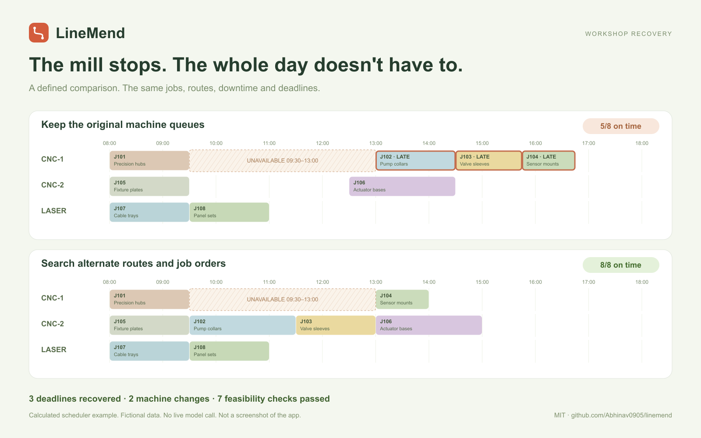

# LineMend

**A machine went down. Which orders can still finish today?**

LineMend helps a small fabrication workshop repair its daily plan after a breakdown, late material delivery or changed deadline. NVIDIA Nemotron reads the handover note through Nebius Token Factory. A local scheduling engine searches compatible machine routes and job orders, then checks the proposed schedule.

The guided demo follows four sections: the workshop problem, the approach, the note and constraints, then the calculated result. The supervisor can inspect source quotes, correct a constraint, compare against keeping the old queue, change the repair time and export a schedule with its evidence.

Built for the **Nebius x NVIDIA Global AI Hackathon**, Best Apps and Agents track. New project created October 29, 2026. MIT licensed.

## Current status

- [Open the public demo](https://linemend.linemend.workers.dev). Anonymous page access and a real hosted Nemotron extraction passed; the returned constraints produced a checked 8/8 recovery. See [Cloudflare verification](artifacts/cloudflare-live-check.json).
- 22 automated tests pass, including 60 generated disruption cases.
- Three fictional workshop examples work without credentials. They are marked **Example constraints - no model call**.
- **Live Nebius inference passed five checks with NVIDIA Nemotron 3 Super:** exact extraction for three fictional examples and clarification for two ambiguous/unknown-target notes. [Request receipts and results](artifacts/live-nebius-results.json) are saved. A missing or rejected key produces an error; there is no fake model fallback.
- Browser QA passed for all three examples, schedule comparisons, repair-time edits, valid/invalid imports and CSV/JSON exports. Desktop and narrow responsive layouts were inspected in Safari.
- [Watch the 2:38 demo](https://www.youtube.com/watch?v=xEctEMZColA): the problem, approach, two live Nemotron calls, calculated results and evidence export. English captions are included.
- [Submitted to Devpost](https://devpost.com/software/linemend) on October 30, 2026 at 9:27 AM Pacific. The [submission receipt](artifacts/devpost-submission-receipt.json) and [video verification](artifacts/demo-verification.json) record the checks.



See [HANDOFF.md](HANDOFF.md) for the exact resume sequence and verified service IDs.

## Run locally

Node.js 22.13 or later is required. Use Node 22.18 or later for the native TypeScript test command.

```sh
npm ci
cp .dev.vars.example .dev.vars
npm run dev -- --host 127.0.0.1 --port 5173
```

Open `http://127.0.0.1:5173/`.

For the no-key example, select **Machine breakdown**, choose **Or review the example constraints**, inspect them, then click **Confirm & recover**. Switch between **Recovery**, **Keep the old queue** and **Original plan**. Explore a later repair time. The CSV and JSON report are available through **Export plan**.

For live interpretation, add your key to the ignored `.dev.vars` file and restart the dev server:

```text
NEBIUS_API_KEY=<your Token Factory key>
NEBIUS_MODEL=nvidia/nemotron-3-super-120b-a12b
```

The browser never receives the API key. Do not commit `.dev.vars`. The hosted application needs the same values in its server environment.

For a local preview of the production Cloudflare build, create the D1 quota table once and start Wrangler:

```sh
npm run build:cloudflare
npx --yes wrangler@4.156.0 d1 migrations apply DB --local --config wrangler.cloudflare.jsonc --persist-to .wrangler/cloudflare-local
npx --yes wrangler@4.156.0 dev --config dist/server/wrangler.json --local --persist-to .wrangler/cloudflare-local --port 5174
```

Open `http://127.0.0.1:5174/`. Only aggregate request counts are stored; workshop notes are not. The [Cloudflare deployment guide](docs/cloudflare-deployment.md) covers the public deployment. Replace the account and database IDs with your own when deploying a fork.

## NVIDIA and Nebius integration

`lib/nebius.ts` calls `https://api.tokenfactory.nebius.com/v1/chat/completions` at runtime. Its default model is `nvidia/nemotron-3-super-120b-a12b`. The model extracts four constraint types using a strict JSON schema:

- `machine_down`: a machine and an unavailable interval
- `material_delay`: a job and its material-ready time
- `deadline`: a job and revised due time
- `lock_job`: a named job that must keep its original slot

The request includes only the note and a dictionary of machine/job IDs and names. Scheduling data stays in the deterministic planner. The response must identify known entities and supply exact source quotes containing its times. Ambiguous or unsupported operational requests belong in a clarification list. Clarifications block planning until the note is corrected and interpreted again.

A successful live response records the returned model name, request ID, input/output token counts, latency and timestamp. Errors, truncated output, invalid JSON and failed evidence checks stop the flow. Unit tests use clearly identified fake responses and do not establish live provider access.

The final five-case live run took 0.78-3.88 seconds per model call. A preceding one-note comparison found an unsupported job lock in Nano's response; evidence validation rejected it. Super was selected after the five-case check passed. This is a small fixture evaluation, not a general model benchmark. See [the verification notes](docs/live-verification.md).

Official API references: [quickstart](https://docs.tokenfactory.nebius.com/quickstart), [structured output](https://docs.tokenfactory.nebius.com/ai-models-inference/json).

## How scheduling works

The model does not calculate the schedule. A deterministic bounded search tries dispatch orders, compatible machine routes and earliest/original-start placements. The ranking is lexicographic:

1. Fewest late or unscheduled jobs
2. Fewest unscheduled jobs
3. Least priority-weighted tardiness
4. Fewest changed jobs
5. Fewest machine changes
6. Least total displacement from original start times

The search has a 70,000-state budget. It reports whether it exhausted its candidate space. **It does not claim global optimality.** The comparison policy keeps each original machine queue and shifts jobs forward around downtime and material delays without reordering or rerouting.

A separate validator checks every job, allowed routes and durations, machine overlaps, downtime, material availability, locked work and shift boundaries. Deadlines are a soft objective: a feasible schedule may still contain late jobs, which remain visible.

The bottleneck calculation ignores competing movable work and finds the earliest completion on each allowed route. If even that lower bound misses the deadline, the app can show a specific minimum shortfall. It never calls a missed promise on time.

## Reproducible examples

All data is fictional. No real workshop or customer results are claimed.

| Scenario | Old queue on time | Recovered on time | Unavoidable shortfall |
| --- | --- | --- | --- |
| CNC-1 outage + J106 stock at 12:30 | 5/8 | 8/8 | None in this example |
| J102 material arrives after its deadline | 5/8 | 7/8 | J102 at least 150 minutes late |
| CNC-1 outage + earlier J104 deadline | 5/8 | 7/8 | J104 at least 30 minutes late |

Run `npm test` to reproduce these assertions and the generated cases. `artifacts/scenario-results.json` contains calculated outputs. These examples demonstrate software behavior, not field accuracy or money saved.

## Import and export

The **Orders** view downloads the workshop JSON template. The app accepts up to 10 jobs and 6 machines. Imports reject duplicate IDs, unknown or repeated routes, invalid times and overlapping original slots. `artifacts/workshop.json` is the same template.

CSV exports contain order, route, start/finish, deadline and status. JSON reports contain the source note, model interpretation, manually reviewed constraints, comparison baseline, recovered schedule, validation checks and bottlenecks. Exports are proposals. The app sends no machine commands or customer messages.

## Checks

```sh
npm test
npm run typecheck
npm run build:cloudflare
```

The 22 tests cover examples, impossible schedules, frozen-work conflicts, overlap and route rejection, import validation, quote/time evidence, model errors and 60 generated disruptions. The provider tests are mocked. Live smoke testing is a separate step with `node --env-file=.dev.vars --experimental-strip-types scripts/live-check.ts`.

The app uses React, TypeScript and Vinext. The public demo runs directly on Cloudflare Workers with D1. It does not depend on the earlier Sites host. See the [deployment guide](docs/cloudflare-deployment.md). GitHub Actions runs the tests, type checking and both build targets on push.

## Limits

This is a one-shift, single-operation prototype. Durations include fixed setup allowances. Shared operators, multi-stage production, sequence-dependent setup, overtime, maintenance certification and multi-day planning are outside the model. Machine compatibility comes from the input; the app does not certify it.

Quote checks establish textual grounding, not correct interpretation of every sentence. Human review remains necessary. The API has bounded input size, per-visitor throttling and a shared D1 request budget of 100 calls per UTC day and 300 calls total. Each request reserves a slot atomically before contacting Nebius; failed provider calls count too. Deploys do not reset the total. Missing quota storage stops inference. This caps requests through this demo, not usage from other apps or direct use of the same API key.

Live requests send the note and machine/job names to Nebius. The app does not persist inputs on its server. This prototype is not connected to a real production system.

## AI assistance

AI was used for implementation.
